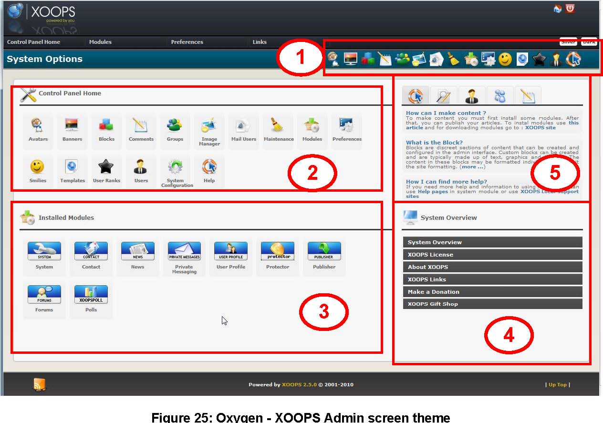
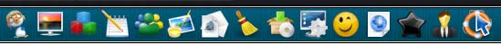
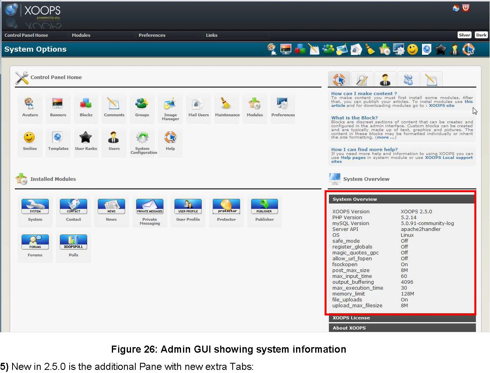
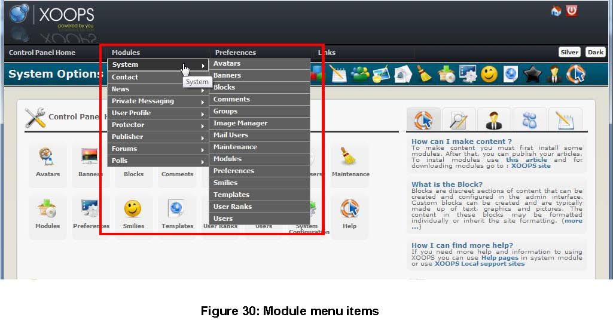
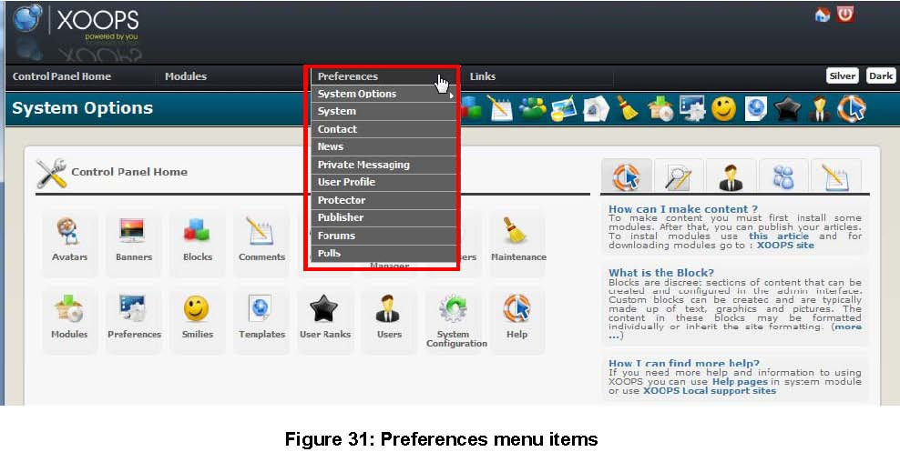
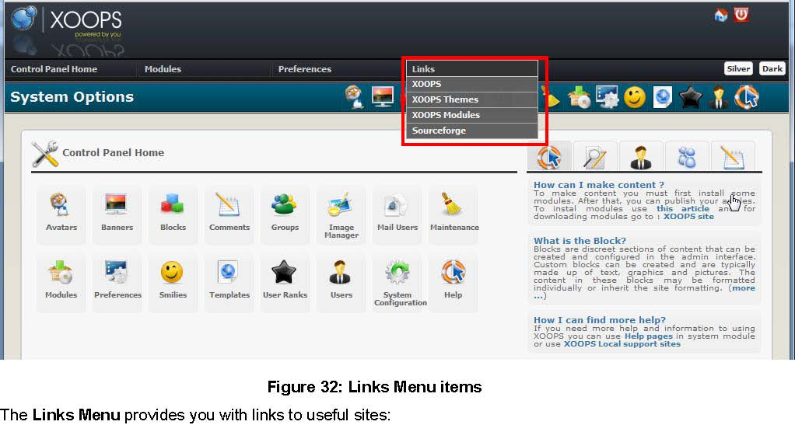

# Appendix 1: Working with the XOOPS Admin GUI

XOOPS 2.7.0 ships four admin themes that can be switched from the user profile. The 2.5.x "Oxygen" admin theme has been retired.

## Admin themes

| Theme        | Description                                                                                         |
| ------------ | --------------------------------------------------------------------------------------------------- |
| `default`    | The standard admin theme, updated for 2.7.0 with Bootstrap 5 and Font Awesome 6.                    |
| `dark`       | Dark-mode variant of the default admin theme.                                                       |
| `modern`     | **New in 2.7.0.** A refreshed layout that is the recommended default for most administrators.      |
| `transition` | An intermediate theme that preserves some 2.5.x admin look-and-feel for users migrating gradually. |

Users can pick their preferred admin theme from their profile; the default for new sites is the `default` admin theme.

## Template overload

A change in 2.7.0 is that system admin themes now support **template overload**. This means you can override a specific admin template in your own admin theme without touching the core files, and the core theme will continue to provide every template you have not overridden. This makes it much easier to brand the admin area or patch a single screen without forking an entire theme.

## Dashboard layout

The admin dashboard contains the familiar XOOPS sections:

- **Toolbar** at the top — quick access to System operations (Avatars, Banners, Blocks, Comments, Groups, Image Manager, Mail Users, Maintenance, Modules, Preferences, Smilies, Templates, User Ranks, Users, Help).

  

- **System panel** — the System Options are also accessible through a dedicated panel.
- **Installed Modules panel** — shows icons for the currently installed modules. Modules can now also carry their own sidebar/menu icons; see the 2.7.0 release notes for the `menu icons for modules` feature.
- **System Overview panel** — current system values (PHP and server versions, major configuration values), plus an **Admin Composer packages info** view (new in 2.7.0) that lists installed Composer libraries and their versions.

  

## Control Panel menu

The Control Panel menu offers:

| Menu Item   | Description                                   |
| ----------- | --------------------------------------------- |
| Home Page   | Go to the site home page.                     |
| XOOPS News  | Pulls the latest XOOPS news from xoops.org.   |
| Logout      | Log out of the administrator session.         |

The **Modules menu** lists every installed module with a submenu for each module's admin options.

The **Preferences menu** shows preferences for XOOPS itself plus preferences per installed module.

## Useful links

- [XOOPS main website](https://xoops.org)
- [XOOPS modules repository](https://github.com/XoopsModules25x)
- [XOOPS themes gallery](https://github.com/XoopsThemes)
- [XoopsCore27 on GitHub](https://github.com/XOOPS/XoopsCore27)
