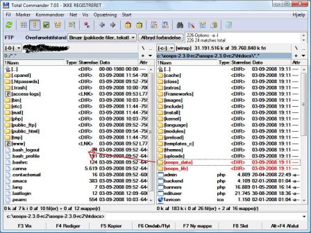
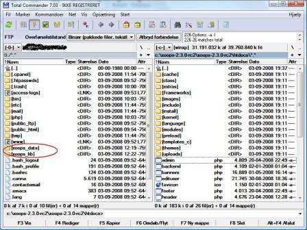
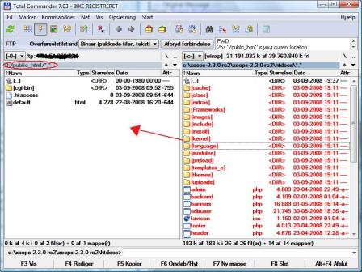

# Appendix 2: Uploading XOOPS via FTP

This appendix walks through deploying XOOPS 2.7.0 to a remote host using FTP or SFTP. Any control panel (cPanel, Plesk, DirectAdmin, etc.) will expose the same underlying steps.

## 1. Prepare the database

Through your host's control panel:

1. Create a new MySQL database for XOOPS.
2. Create a database user with a strong password.
3. Grant the user full privileges on the newly created database.
4. Record the database name, username, password, and host — you will enter them into the XOOPS installer.

> **Tip**
>
> Modern control panels generate strong passwords for you. Since the application stores the password in `xoops_data/data/secure.php`, you do not need to type it often — prefer a long, randomly generated value.

## 2. Create an administrator mailbox

Create an email mailbox that will receive site administration notifications. The XOOPS installer asks for this address during the webmaster account setup and validates it with `FILTER_VALIDATE_EMAIL`.

## 3. Upload the files

XOOPS 2.7.0 ships with its third-party dependencies pre-installed in `xoops_lib/vendor/` (Composer packages, Smarty 4, HTMLPurifier, PHPMailer, Monolog, TCPDF, and more). This makes `xoops_lib/` significantly larger than in 2.5.x — expect tens of megabytes.

**Do not selectively skip files inside `xoops_lib/vendor/`.** Skipping files in the Composer vendor tree will break autoloading and the install will fail.

Upload structure (assuming `public_html` is the document root):

1. Upload `xoops_data/` and `xoops_lib/` **next to** `public_html`, not inside it. Placing them outside the web root is the recommended security posture for 2.7.0.

   ```
   /home/your-user/
   ├── public_html/
   ├── xoops_data/     ← upload here
   └── xoops_lib/      ← upload here
   ```

   
   

2. Upload the remaining contents of the distribution `htdocs/` directory into `public_html/`.

   

> **If your host does not allow directories outside the document root**
>
> Upload `xoops_data/` and `xoops_lib/` **inside** `public_html/` and **rename them to non-obvious names** (for example `xdata_8f3k2/` and `xlib_7h2m1/`). You will enter the renamed paths into the installer when it asks for the XOOPS Data Path and XOOPS Library Path.

## 4. Make writable directories writable

Through the FTP client's CHMOD dialog (or SSH), make the directories listed in Chapter 2 writable by the web server. On most shared hosts, `0775` on directories and `0664` on `mainfile.php` are sufficient. `0777` is acceptable during installation if your host runs PHP under a user other than the FTP user, but tighten the permissions after the install completes.

## 5. Launch the installer

Point your browser at the public URL of the site. If all files are in place, the XOOPS Installation Wizard starts and you can follow the rest of this guide from [Chapter 2](chapter-2-introduction.md) onwards.
