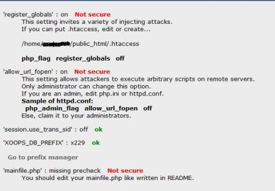

# Appendix 5: Increase the security of your XOOPS installation

After installing XOOPS 2.7.0, take the following steps to harden the site. Each step is optional individually, but together they raise the baseline security of the install significantly.

## 1. Install and configure the Protector module

The bundled `protector` module is the XOOPS firewall. If you did not install it during the initial wizard, install it from the Admin → Modules screen now.



Open Protector's admin panel and review the warnings it displays. Legacy PHP directives such as `register_globals` no longer exist (PHP 8.2+ has removed them), so you will not see those warnings anymore. Current warnings usually relate to directory permissions, session settings, and trust-path configuration.

## 2. Lock down `mainfile.php` and `secure.php`

When the installer finishes it tries to mark both files as read-only, but some hosts revert the permissions. Verify and re-apply if needed:

- `mainfile.php` → `0444` (owner, group, other read-only)
- `xoops_data/data/secure.php` → `0444`

`mainfile.php` defines the path constants (`XOOPS_ROOT_PATH`, `XOOPS_PATH`, `XOOPS_VAR_PATH`, `XOOPS_URL`, `XOOPS_COOKIE_DOMAIN`, `XOOPS_COOKIE_DOMAIN_USE_PSL`) and production flags. `secure.php` holds the database credentials:

- In 2.5.x, the database credentials used to live in `mainfile.php`. They are now stored in `xoops_data/data/secure.php`, which is loaded by `mainfile.php` at runtime. Keeping `secure.php` inside `xoops_data/` — a directory you are encouraged to relocate outside the document root — makes it much harder for an attacker to reach the credentials over HTTP.

## 3. Move `xoops_lib/` and `xoops_data/` outside the document root

If you have not already done so, move these two directories one level above your web root and rename them. Then update the corresponding constants in `mainfile.php`:

```php
define('XOOPS_ROOT_PATH', '/home/you/www');
define('XOOPS_PATH',      '/home/you/zubra_mylib');
define('XOOPS_VAR_PATH',  '/home/you/zubra_mydata');
define('XOOPS_TRUST_PATH', XOOPS_PATH);
```

Placing these directories outside the document root prevents direct access to Composer's `vendor/` tree, cached templates, session files, uploaded data, and the database credentials in `secure.php`.

## 4. Cookie domain configuration

XOOPS 2.7.0 introduces two cookie-domain constants in `mainfile.php`:

```php
// Use the Public Suffix List (PSL) to derive the registrable domain.
define('XOOPS_COOKIE_DOMAIN_USE_PSL', true);

// Explicit cookie domain; may be blank, the full host, or the registrable domain.
define('XOOPS_COOKIE_DOMAIN', '');
```

Guidelines:

- Leave `XOOPS_COOKIE_DOMAIN` blank if you serve XOOPS from a single hostname or from an IP.
- Use the full host (e.g. `www.example.com`) to scope cookies to that hostname only.
- Use the registrable domain (e.g. `example.com`) when you want cookies shared across `www.example.com`, `blog.example.com`, etc.
- `XOOPS_COOKIE_DOMAIN_USE_PSL = true` lets XOOPS correctly split compound TLDs (`co.uk`, `com.au`, …) instead of accidentally setting a cookie on the effective TLD.

## 5. Production flags in `mainfile.php`

`mainfile.dist.php` ships with these two flags set to `false` for production:

```php
define('XOOPS_DB_LEGACY_LOG', false); // disable legacy SQL usage logging
define('XOOPS_DEBUG',         false); // disable debug notices
```

Leave them off on production. Enable them temporarily in a development or staging environment when you want to:

- hunt down lingering legacy database calls (`XOOPS_DB_LEGACY_LOG = true`);
- surface `E_USER_DEPRECATED` notices and other debug output (`XOOPS_DEBUG = true`).

## 6. Delete the installer

After the install is complete:

1. Delete any renamed `install_remove_*` directory from the web root.
2. Delete any `install_cleanup_*.php` script that the wizard created during cleanup.
3. Confirm the `install/` directory is no longer reachable over HTTP.

Leaving a disabled but present installer directory is a low-severity but avoidable risk.

## 7. Keep XOOPS and modules up to date

XOOPS follows a regular patch cadence. Subscribe to the XoopsCore27 GitHub repository for release notifications, and update your site and any third-party modules whenever a new release ships. The security updates for 2.7.x are published via the repository's Releases page.
