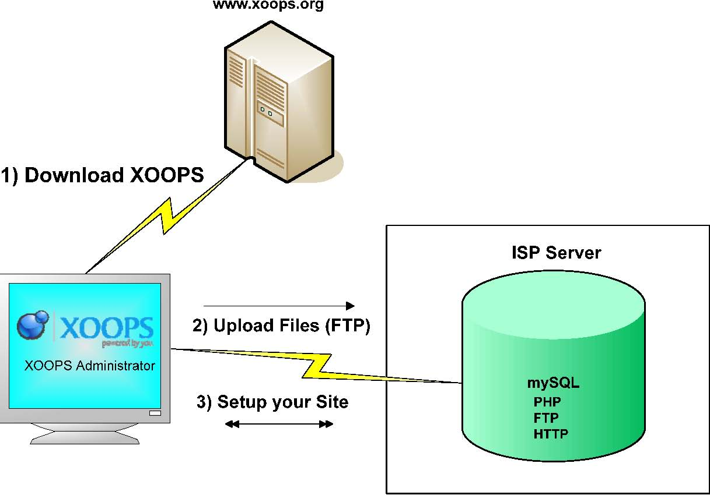

# Chapter 1: Preamble

Welcome to the XOOPS Installation Guide.

This guide assists with the installation of a new XOOPS 2.7.0 site, assuming the hosting environment is already established, and with upgrading an existing XOOPS site to 2.7.0.

The XOOPS Documentation Team is working to build new and update existing basic documents for all users to have a useful repository. We have little time to cover a lot of ground, so please be patient.

We welcome your comments, reviews, opinions and in general whatever feedback you can provide us to make this guide a better tool for other XOOPS users

_**The XOOPS Documentation Team**_

Figure 1: Installation Process

