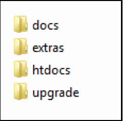
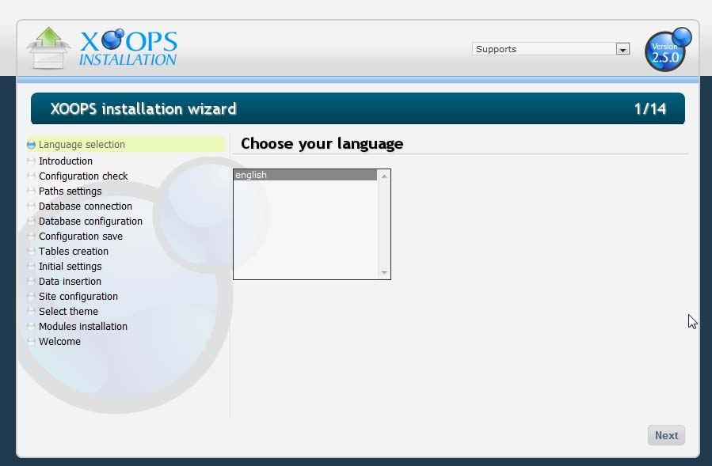

# Chapter 2: Introduction

The XOOPS Installation Guide provides an overview of how to install XOOPS 2.7.0 on your web server. It assumes you already have a working **LAMP**, **WAMP**, or equivalent environment (Linux/Windows/macOS + web server + PHP + MySQL).

Efforts have been made to ensure this is not merely a sequential installation document. Useful tips and pointers about XOOPS are provided as the user is guided through the installation process.

If you require an installation in a language other than English, please skip now to [Appendix 3](appendix-3-translating-xoops-to-local-language.md) and review the translation information before starting the installation.

## System Requirements

XOOPS 2.7.0 has explicit minimum and recommended versions for its runtime stack.

| Component  | Minimum                               | Recommended            |
| ---------- | ------------------------------------- | ---------------------- |
| PHP        | 8.2.0                                 | 8.4 or later           |
| MySQL      | 5.7.8                                 | 8.4 or later           |
| Web server | Any server supporting required PHP    | Apache or Nginx        |

Notes:

- IIS is still possible, but Apache and Nginx are the supported and recommended examples.
- XOOPS 2.7.0 is compatible with MySQL 9.0.
- SELinux-enabled systems (CentOS/RHEL) may require additional security-context changes in addition to normal file permissions.

### Required PHP extensions

The installer's Configuration Check page enforces the following:

- **MySQLi**
- **Session**
- **PCRE**
- **filter**
- **`file_uploads`** enabled in `php.ini`
- **fileinfo**

### Recommended PHP extensions

- **mbstring** — multibyte character encoding
- **intl** — internationalization
- **iconv** — character-set conversion
- **xml** — XML parsing
- **zlib** — compression
- **gd** — image functions
- **exif** — image metadata
- **curl** — HTTP client

## Downloading XOOPS 2.7.0

Download the release package from GitHub Releases:

- [https://github.com/XOOPS/XoopsCore27/releases](https://github.com/XOOPS/XoopsCore27/releases)

Both ZIP and TAR archives are available. Unpack the archive with your preferred tool (for example 7-Zip — see the "Useful Tools" appendix).

The resulting directory contains four subdirectories:

- **`docs/`** — change log, GNU GPL license, credits file, and supporting documentation
- **`extras/`** — optional files for specific configurations (read the `*.txt` files for explanations)
- **`htdocs/`** — the XOOPS site code; this is what gets deployed to your web root
- **`upgrade/`** — files used to upgrade an existing XOOPS site (see Chapter 9)

## Preparing files on the server

1. Copy the contents of the `htdocs/` subdirectory to the location where your web server will serve them. For a local WAMP install, this is typically the `www` folder. For a remote host, this is typically `public_html`, `httpdocs`, `html`, or `web`.

   > **Caution**
   >
   > Only the *contents* of `htdocs/` should be uploaded to the web root — not the `htdocs/` folder itself. Otherwise your site will live at `http://www.yoursite.com/htdocs/`.

2. For a local installation, ensure your web server is running.

3. Ensure the following files and directories are writable by the web server before launching the wizard:

   **File**

   - `mainfile.php`

   **Upload directories**

   - `uploads/`
   - `uploads/avatars/`
   - `uploads/files/`
   - `uploads/images/`
   - `uploads/ranks/`
   - `uploads/smilies/`

   **XOOPS data directories**

   - `xoops_data/`
   - `xoops_data/caches/`
   - `xoops_data/caches/xoops_cache/`
   - `xoops_data/caches/smarty_cache/`
   - `xoops_data/caches/smarty_compile/`
   - `xoops_data/configs/`
   - `xoops_data/configs/captcha/`
   - `xoops_data/configs/textsanitizer/`
   - `xoops_data/data/`
   - `xoops_data/protector/`

   On Linux/macOS, `chmod 0775` on directories and `0664` on `mainfile.php` is usually sufficient (adjust ownership so the web server user can write). `0777` works on shared hosts but should be tightened once the install is complete.

4. Enter the applicable address into a browser. On a local machine this is typically `http://localhost/xoops`; on a remote host, it is your domain name. If the files are in place, accessing the site launches the XOOPS Installation Wizard.

   > **Note**
   >
   > You can run several XOOPS sites on the same server by placing each site in its own subfolder (e.g. `www/01_xoops/`, `www/02_xoops/`, etc.). The wizard distinguishes the web server root from the individual XOOPS root.

5. The wizard opens with a language selection screen:

   

   Figure 2: Language selection page of the XOOPS installation wizard

   > **Resources**
   >
   > If you would like to install XOOPS in a language other than English, visit the XOOPS project site or a local XOOPS support site for translations.

   If a translation you need does not exist, copy `install/language/english/` to a new folder with the language name and translate the PHP constants. See [Appendix 3](appendix-3-translating-xoops-to-local-language.md) for details. New translations are always welcome.

6. Click **[Next]** to proceed to the introduction screen. This screen summarizes XOOPS, the GPL license, system requirements, and pre-installation requirements.

   

   Figure 3: XOOPS Installation Assistant

   The Installation Assistant outlines the environment required for successful installation:

   1. **Set up the web server, PHP, and database properly.** The web server must be active and able to process PHP files, and a MySQL server must be running. You must have database credentials.
   2. **Prepare a database for your XOOPS site.** On remote hosts, create the database ahead of time through your control panel. On a local install, the wizard can create the database for you.
   3. **Prepare a user account with access to the database.**
   4. **Make the required directories and files writable** (see the list above).
   5. **For security, move `xoops_lib/` and `xoops_data/` out of the document root** and rename them to non-obvious names. Beginners may leave them in place and move them after a successful install.
   6. **Ensure the writable directories inside `xoops_data/` exist.**
   7. **Turn on cookies and JavaScript in your browser.** Both are required by XOOPS.

   Confirm these requirements are met and click **[Next]**.
