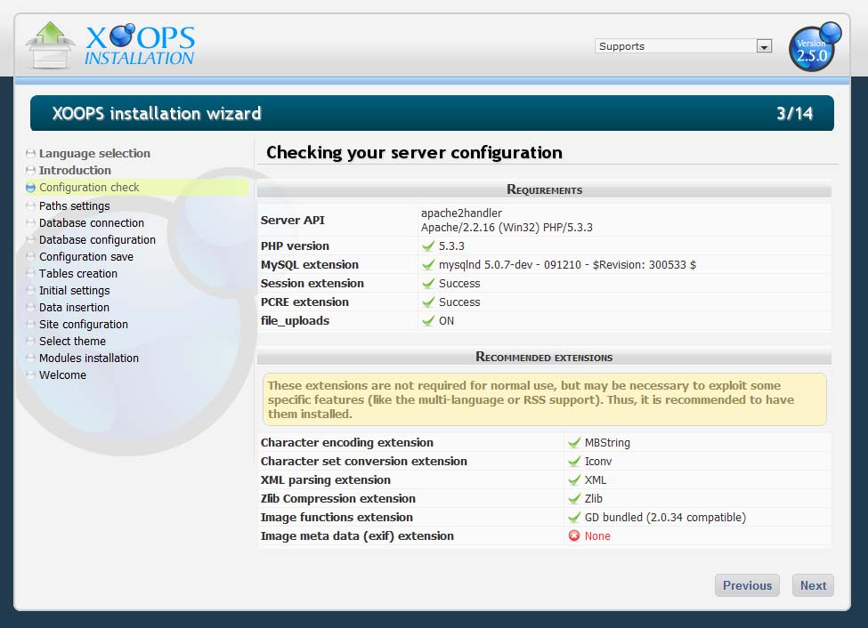

# Chapter 3: Server Configuration Check

The Installation Wizard now checks your server configuration and splits the results into two blocks: **Requirements** (hard failures) and **Recommended extensions** (soft warnings).

Figure 4: Server configuration check

## Requirements

These entries must all succeed. If any of them fail, fix the environment before continuing; XOOPS 2.7.0 will not run otherwise.

| Check              | Why it matters                                                     |
| ------------------ | ------------------------------------------------------------------ |
| Server API         | Shows your web server software and PHP SAPI mode.                  |
| PHP version        | Must be **PHP 8.2.0 or later**.                                    |
| MySQLi extension   | Required database driver.                                          |
| Session extension  | Required for login and wizard state.                               |
| PCRE extension     | Required for regular expressions used throughout the core.        |
| filter extension   | Required for input sanitization (`filter_var`, etc.).             |
| `file_uploads`     | Must be enabled in `php.ini`.                                      |
| fileinfo extension | Required for MIME-type detection.                                  |

## Recommended extensions

These are not strictly required, but they enable important functionality. Install them whenever possible.

| Extension | Used for              |
| --------- | --------------------- |
| mbstring  | Character encoding    |
| intl      | Internationalization  |
| iconv     | Character conversion  |
| xml       | XML parsing           |
| zlib      | Compression           |
| gd        | Image functions       |
| exif      | Image metadata        |
| curl      | HTTP client           |

If every required entry is green, click **[Next]** to continue.
