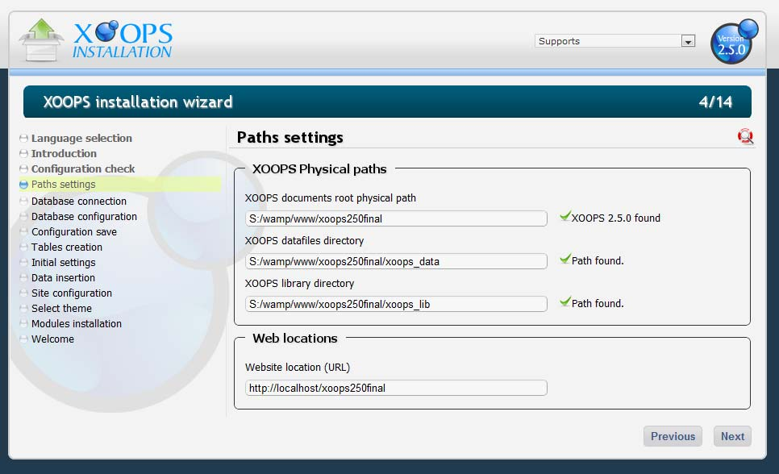
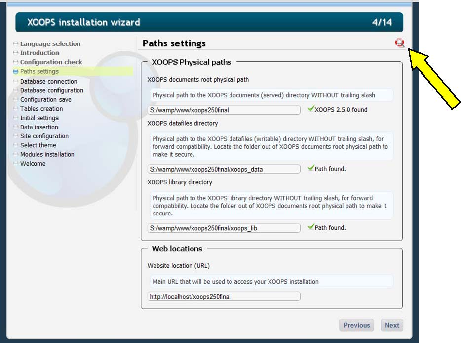
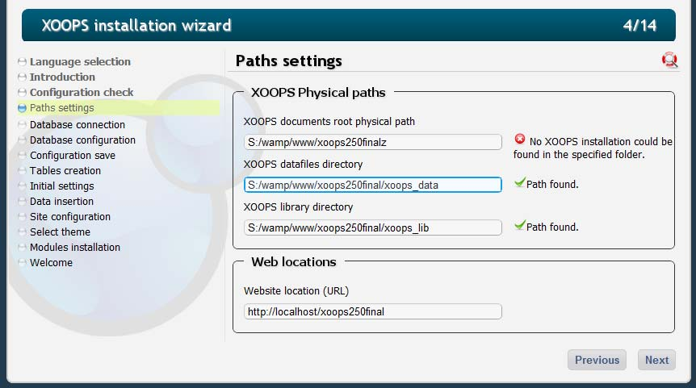
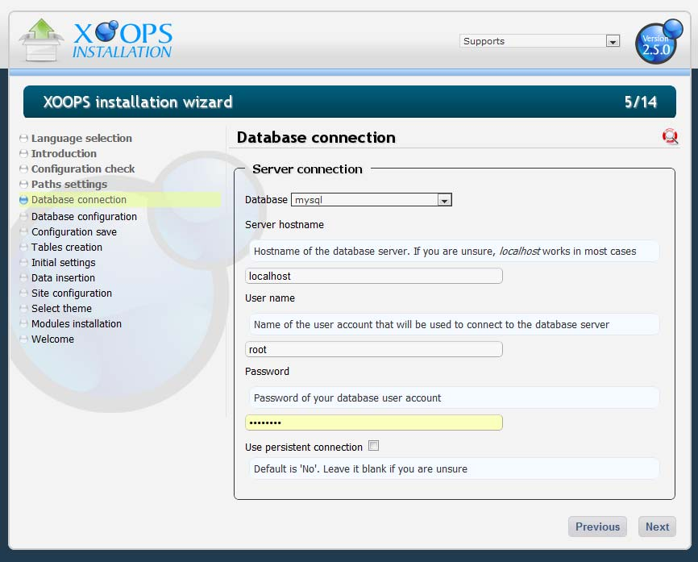
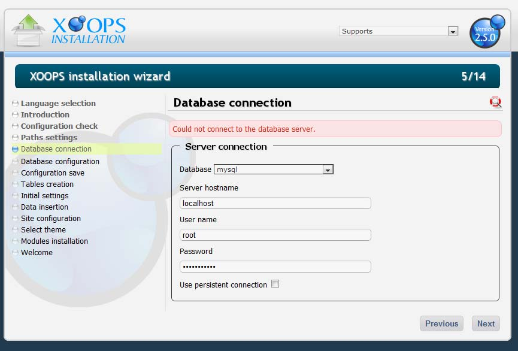
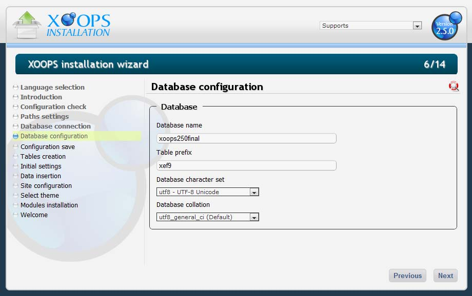

# Chapter 4: Take the Right Path!

In this step the Installation Wizard collects the filesystem paths and URLs that will be written to `mainfile.php`. If the files were uploaded correctly, most of the fields are pre-filled for you.



Figure 5: Paths settings page

## Fields

The 2.7.0 installer exposes the following fields:

| Field                  | Description                                                                                              |
| ---------------------- | -------------------------------------------------------------------------------------------------------- |
| **XOOPS Root Path**    | Absolute filesystem path to the `htdocs/` contents (the web-served directory). No trailing slash.        |
| **XOOPS Data Path**    | Absolute filesystem path to `xoops_data/` (writable runtime data). Should be moved outside the web root. |
| **XOOPS Library Path** | Absolute filesystem path to `xoops_lib/` (code libraries and Composer `vendor/`). Also best moved out.   |
| **XOOPS URL**          | Virtual URL to your main XOOPS directory, without a trailing slash.                                      |
| **Cookie Domain**      | Domain used when creating cookies. May be blank, the full host, or the registered domain.                |

The protocol (`http://` / `https://`) is detected automatically at runtime, including reverse-proxy scenarios (`X-Forwarded-Proto`, `X-Forwarded-Ssl`, etc.), so you no longer need to hard-code the scheme in the URL field.



If you are not sure about a field, click the **Help** button next to it (yellow arrow) and the wizard will display in-line instructions:



Figure 6: Inline help for path fields

For the initial install, accept the default locations for the Data and Library directories. Chapter 8 explains how to relocate them safely after installation.

## Composer autoloader check (Library Path)

XOOPS 2.7.0 ships its third-party dependencies through Composer. The wizard now validates that the **XOOPS Library Path** points to a directory that contains a working autoloader at:

```
<library path>/vendor/autoload.php
```

If the autoloader is missing, the wizard will flag the library path as invalid and refuse to move on. This typically means either:

- the `xoops_lib/` directory was not fully uploaded, or
- the path you entered is wrong.

Re-upload the `xoops_lib/` directory from the distribution in full (it includes a pre-built `vendor/` folder — you do not need to run `composer install` yourself) and enter the correct path.

## Path validation errors

If you make an error in a path, the wizard displays a clear error message:





Figure 7: Invalid path field

Once every path shows a green check, click **[Next]**.


