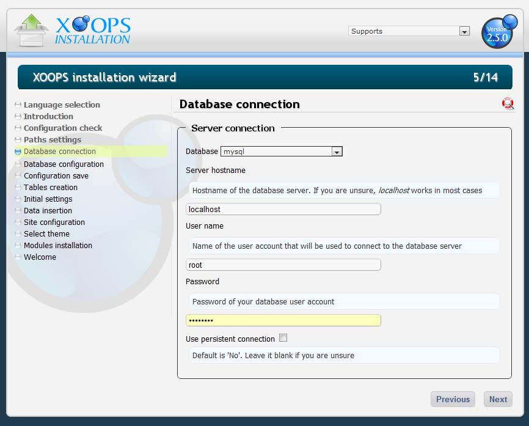
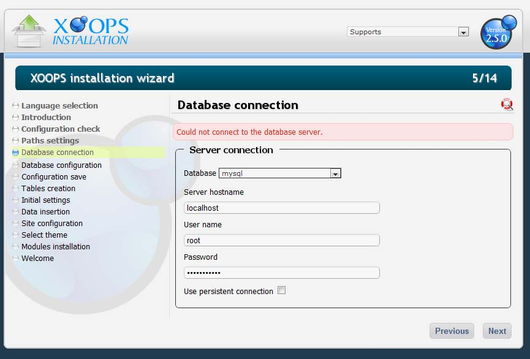
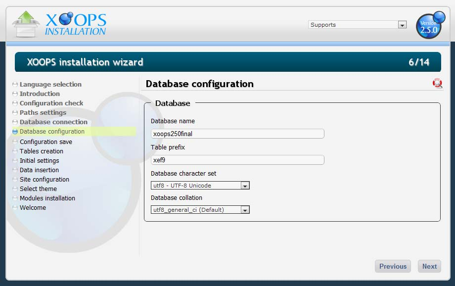

# Chapter 5: Database Connections

With the paths and folder permissions correct, the next step is to configure the database connection.

Figure 8: Database connection details

## Database type

XOOPS 2.7.0 supports **MySQL** only (via the MySQLi extension). The database type selector exists to keep the installer forward-compatible, but `mysql` is the only choice. If the option is missing entirely, an error has occurred and the installation should be restarted.

## Connection fields

- **Server host name** — the host of the MySQL server. Defaults to `localhost`, which is correct for most local installs and many shared hosts.
- **Database username** / **Database password** — credentials for the database. On a local install the default root account usually works. On a remote host, create the user ahead of time through your control panel.
- **Persistent connections** — defaults to **No**. Leave it off unless you know you need persistent connections.

Figure 9: Error displayed when the connection to the MySQL server fails

If XOOPS cannot connect, double-check the host, username, and password and try again.

## Database configuration

Once the wizard establishes a connection, it proceeds to the database configuration screen:

Figure 10: Database configuration

Fields:

- **Database name** — the name of the XOOPS database. If the database does not yet exist, the wizard will attempt to create it for you. Using a name that relates to the site is recommended, especially on servers with multiple XOOPS installs.
- **Table Prefix** — XOOPS prefixes every table with this value followed by an underscore. Keep it short. You can accept the auto-generated value (e.g. `xef9` → tables named `xef9_users`, `xef9_config`, etc.) or use your own. Once the install is complete, this value cannot be changed without a full rebuild.
- **Database character set** — defaults to **`utf8mb4`**. This is the recommended setting for XOOPS 2.7.0 and supports the full Unicode range (including emoji and all CJK characters).
- **Database collation** — the list of valid collations is populated dynamically by the wizard when you change the character set. Accept the default unless you have a specific reason to pick another.

`utf8mb4` is the correct choice for almost every new install. Only change it if you are migrating from an older site that used a different encoding and you want to preserve the previous behavior.
