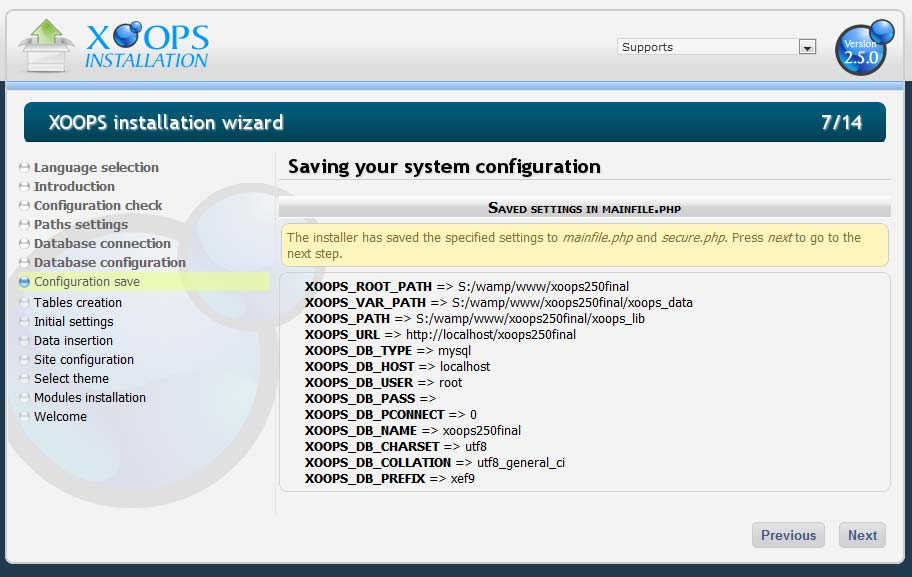
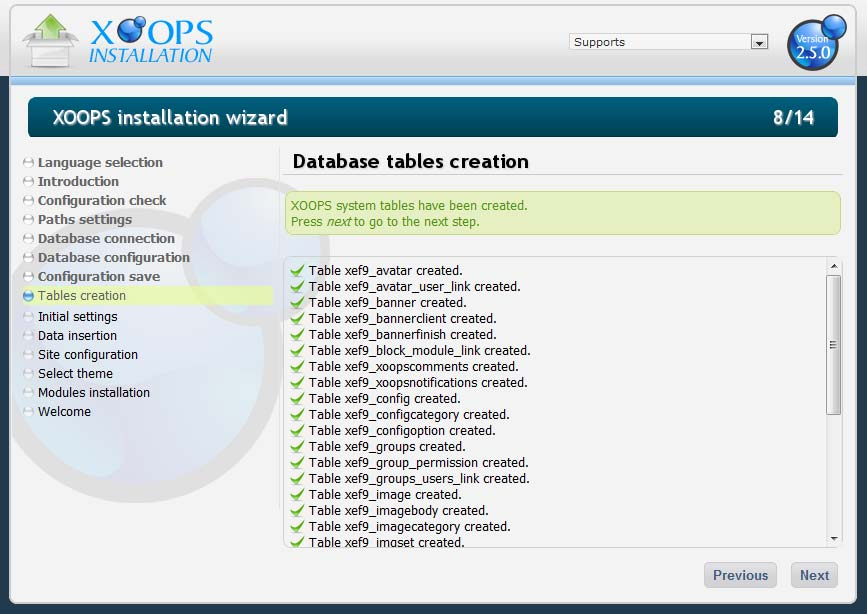

# Chapter 6: Final System Configuration

With the paths and database information collected, the Installation Wizard is ready to write the configuration files and create the database tables.

Figure 11: Review the values you entered before the wizard writes them

## Configuration files written

When you confirm this screen, the wizard writes or copies the following files. The two files in the first group are **always (re)generated** with the values you entered in the wizard. The files in the second group, under `xoops_data/configs/`, are only copied **if they do not already exist**.

**Always regenerated**

- **`mainfile.php`** (from `mainfile.dist.php`) — main XOOPS configuration file; defines `XOOPS_ROOT_PATH`, `XOOPS_PATH`, `XOOPS_VAR_PATH`, `XOOPS_URL`, and cookie-domain constants. If a `mainfile.php` already exists from a previous install, it will be overwritten with the values from this wizard run.
- **`xoops_data/data/secure.php`** (from `secure.dist.php`) — holds the database credentials. Keeping this file inside the (writable) data directory lets you move it outside the web root without editing it. Also always regenerated from the wizard input.

**Copied only if missing**

- **`xoops_data/configs/xoopsconfig.php`** (from `xoopsconfig.dist.php`) — runtime configuration flags consumed by the core.
- **`xoops_data/configs/captcha/*.php`** — working copies of the CAPTCHA config files (`config.php`, `config.image.php`, `config.recaptcha2.php`, `config.text.php`).
- **`xoops_data/configs/textsanitizer/*.php`** — working copies of the text-sanitizer config files (censor, image, mms, rtsp, syntaxhighlight, textfilter, wiki, wmp).

> **Important**
>
> The "copied only if missing" behavior of the `xoops_data/configs/` files matters during upgrades and re-runs of the installer: any local customization you have made to `xoopsconfig.php`, the CAPTCHA configs, or the text-sanitizer configs is preserved automatically. If you instead want the shipped defaults restored, delete the existing file first and re-run the installer (or copy the corresponding `.dist.php` by hand).
>
> Be aware that this preservation does **not** apply to `mainfile.php` and `xoops_data/data/secure.php` — those two are always rewritten from the values you enter in the wizard. If you have hand-edited either of them, back up your changes before re-running the installer.

The generated `mainfile.php` also includes improved HTTPS detection. Protocol selection (`http://` vs `https://`) is handled at runtime and honors reverse-proxy headers:

- `$_SERVER['HTTPS']` (`on`)
- `$_SERVER['SERVER_PORT'] === 443`
- `HTTP_X_FORWARDED_PROTO` / `HTTP_X_FORWARDED_SSL`
- `HTTP_X_FORWARDED_PORT`
- `REDIRECT_HTTPS`

So a XOOPS 2.7.0 site behind a TLS-terminating load balancer or Cloudflare will correctly issue `https://` URLs even when PHP itself sees only plain HTTP.

## Database tables created

If the configuration files are written successfully, the wizard connects to the database and creates the XOOPS tables.

Figure 12: Database table creation list

A new XOOPS 2.7.0 site creates **33 tables** in the System module. Each is created empty and ready to receive data.

| Table                    | Description                                                                                        |
| ------------------------ | -------------------------------------------------------------------------------------------------- |
| `avatar`                 | User avatar identity, path, and name.                                                              |
| `avatar_user_link`       | Ties an avatar to a user.                                                                          |
| `banner`                 | Banner information.                                                                                |
| `bannerclient`           | Banner customers.                                                                                  |
| `bannerfinish`           | Expired banners with their click counts.                                                           |
| `block_module_link`      | Ties blocks to the modules they belong to.                                                         |
| `cache_model`            | Cache model values.                                                                                |
| `config`                 | General XOOPS configuration variables.                                                             |
| `configcategory`         | Configuration categories.                                                                          |
| `configoption`           | Configuration options.                                                                             |
| `group_permission`       | Permissions granted per group.                                                                     |
| `groups`                 | User group identities.                                                                             |
| `groups_users_link`      | Ties users to groups.                                                                              |
| `image`                  | Image metadata.                                                                                    |
| `imagebody`              | Image binary storage, for database-stored images.                                                  |
| `imagecategory`          | Image categories used by the Image Manager.                                                        |
| `imgset`                 | Image set identity.                                                                                |
| `imgset_tplset_link`     | Ties image sets to template sets.                                                                  |
| `imgsetimg`              | Legacy, unused.                                                                                    |
| `modules`                | Installed module information.                                                                     |
| `newblocks`              | Block definitions.                                                                                |
| `online`                 | Online users.                                                                                      |
| `priv_msgs`              | Private messages.                                                                                  |
| `ranks`                  | User ranks defined in the admin area.                                                              |
| `session`                | Active sessions.                                                                                   |
| `smiles`                 | Smilie definitions.                                                                                |
| `tokens`                 | **New in 2.7.0.** CSRF / form-token storage used by the security layer.                           |
| `tplfile`                | Metadata for template-set files.                                                                   |
| `tplset`                 | Template-set registry.                                                                             |
| `tplsource`              | Source data for template-set files stored in the database.                                        |
| `users`                  | User accounts.                                                                                     |
| `xoopscomments`          | Comments.                                                                                          |
| `xoopsnotifications`     | Notifications.                                                                                     |

The list of tables grows each time you install a module. The tables above are the System module only.
