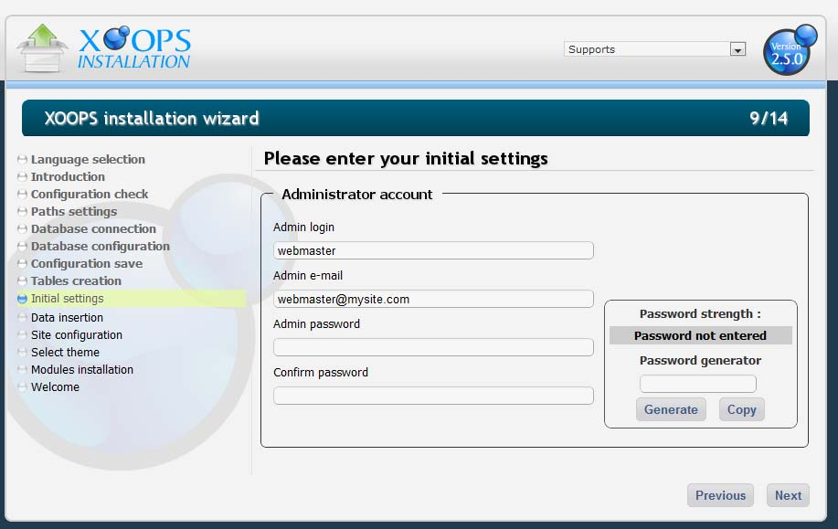
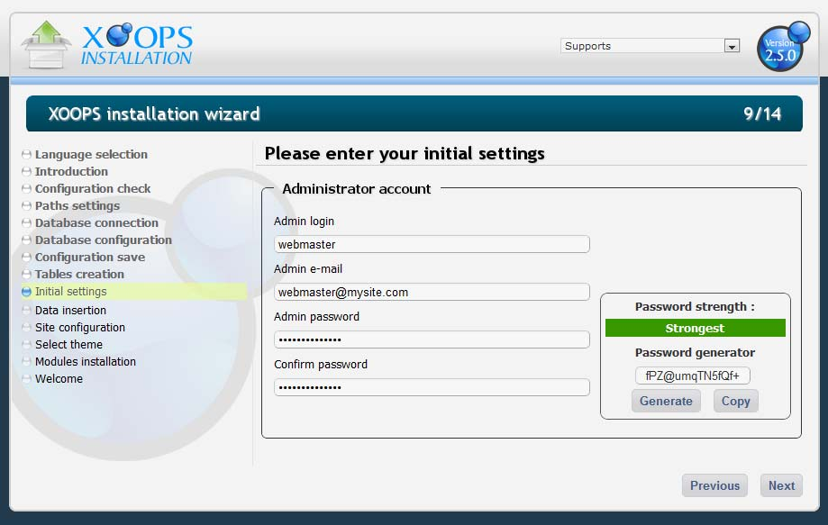
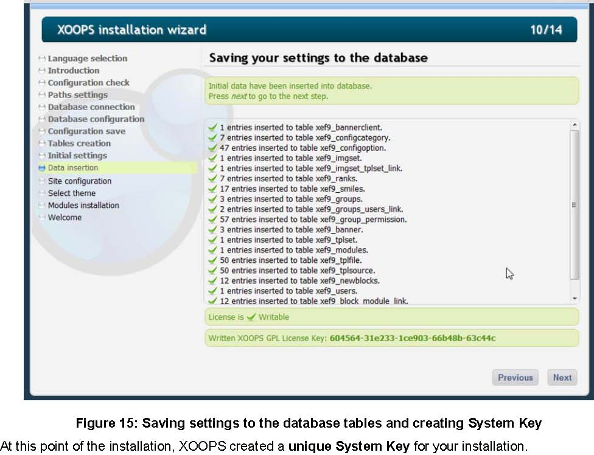
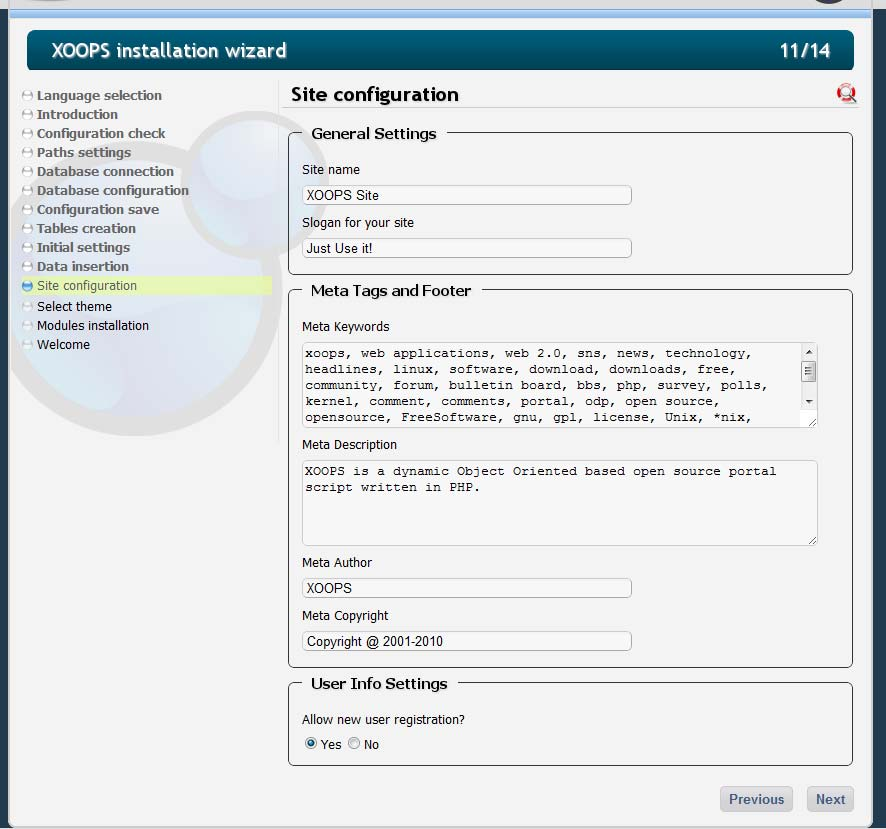
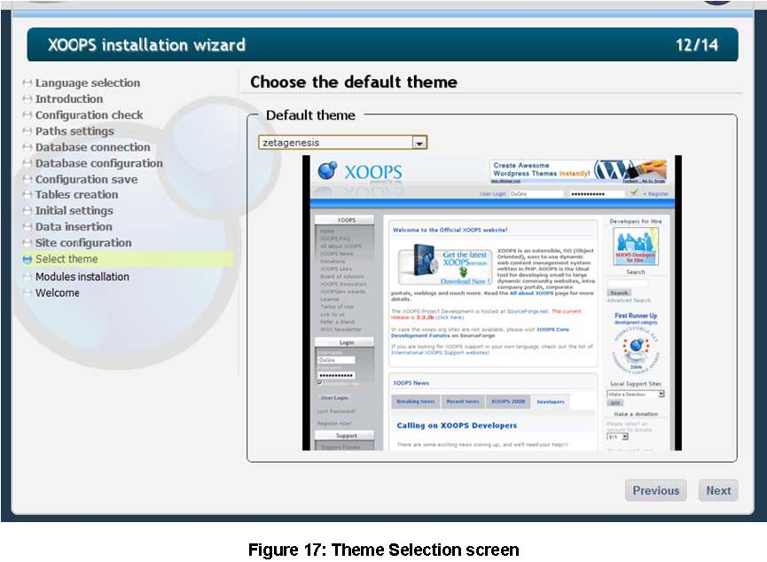
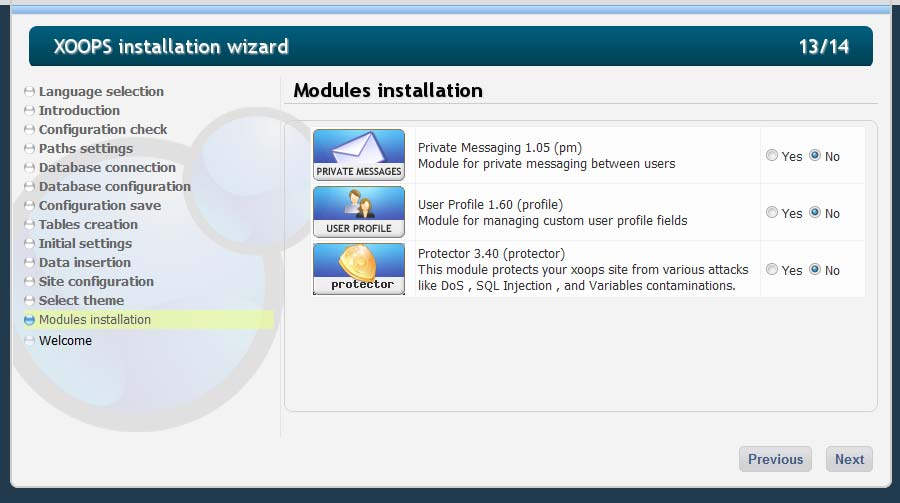
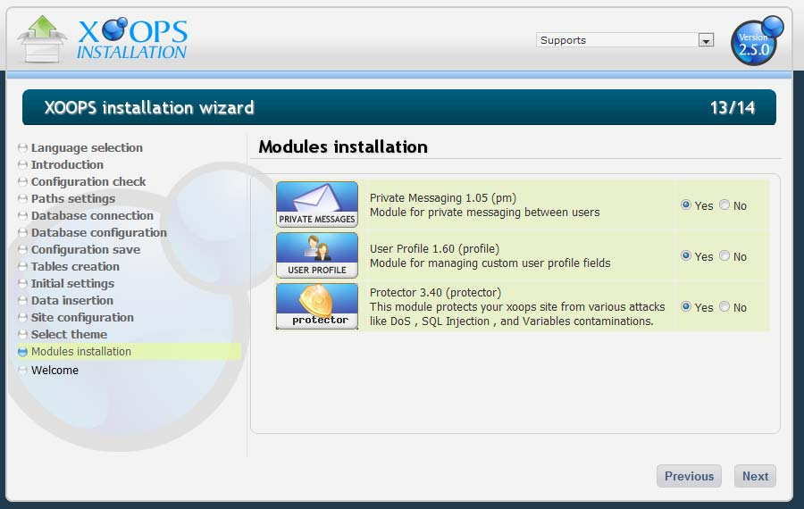
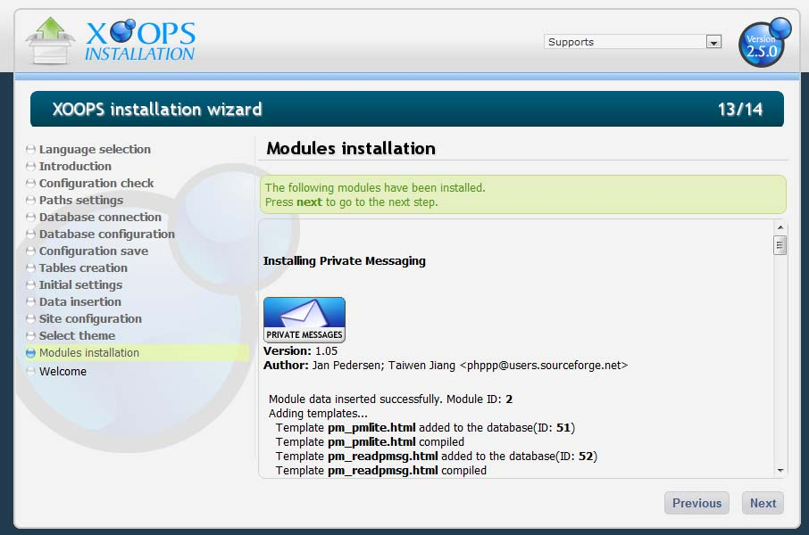

# Chapter 7: Administration Settings

After the tables have been created, the wizard collects the administrator account settings.

Figure 13: Webmaster account form

## Admin account

- **Admin Login** — the site's SuperUser / administrator login name. `webmaster` is a common choice, but any valid name works.
- **Admin e-mail** — the address where mail sent to the administrator should be delivered. The wizard now runs this value through PHP's `FILTER_VALIDATE_EMAIL`, so invalid addresses are rejected and you will be asked to correct them before continuing.
- **Password** and **Confirm Password** — must match.

### Password strength meter

XOOPS 2.7.0 includes a real-time password strength meter (powered by `zxcvbn`). As you type, the meter shows one of: **Very Weak**, **Weak**, **Better**, **Medium**, or **Strong**, with a colored indicator that updates on every keystroke. Choose a password rated **Medium** or better.

### Password generator

Next to the password field is a password generator:

1. Click **Generate** to produce a new 16-character strong password.
2. Click **Copy** to copy it into both password fields.

Figure 14: Password generator + strength meter

It is important that the password be saved somewhere safe (for example in a password manager such as KeePass — see Appendix 4). There is no other way to recover the webmaster credentials later.

Click **[Next]** to save the admin account and continue.

Figure 15: Saving settings to the database tables

## Installation-time license data

XOOPS 2.7.0 still generates a unique installation identifier, but the file that stores it has moved.

- **Old location (2.5.x):** `/include/license.php` — had to be writable during installation.
- **New location (2.7.0):** `xoops_data/data/license.php` — lives in the writable `xoops_data/` tree alongside `secure.php`.

`htdocs/include/license.php` still exists, but it is now a deprecated wrapper that loads the real file from `XOOPS_VAR_PATH`. You no longer need to `chmod` `/include/license.php` during installation.

## Initial data inserted

At this stage the wizard populates the System module tables with default data:

| Table                | Default data                                                                                                                              |
| -------------------- | ----------------------------------------------------------------------------------------------------------------------------------------- |
| `banner`             | 3 default XOOPS banners from `images/banners/`.                                                                                           |
| `bannerclient`       | 1 entry — XOOPS itself as the client for the three default banners.                                                                       |
| `block_module_link`  | 12 entries — one per default System block.                                                                                                |
| `config`             | General configuration values (site name, meta, mail, search, etc.).                                                                       |
| `configcategory`     | Configuration categories surfaced in the System preferences screen.                                                                       |
| `configoption`       | Default option values.                                                                                                                    |
| `groups`             | 3 entries — Webmasters, Registered Users, Anonymous Users.                                                                                |
| `group_permission`   | Default per-group read/admin permissions for the System module and its blocks.                                                            |
| `groups_users_link`  | Links the admin user into the Webmasters and Registered Users groups.                                                                     |
| `imgset`             | 1 entry — the default image set.                                                                                                          |
| `imgset_tplset_link` | Links the default image set to the default template set.                                                                                  |
| `modules`            | 1 entry — the System module.                                                                                                              |
| `newblocks`          | 12 entries — default System blocks (User Menu, Login, Search, Waiting Contents, Main Menu, Site Info, Who's Online, etc.).                |
| `ranks`              | Default user ranks (Just popping in, Not too shy to talk, Quite a regular, Just can't stay away, Home away from home, Moderator, Webmaster). |
| `session`            | Initial session row.                                                                                                                      |
| `smiles`             | 17 default smilies used by the XOOPS editors.                                                                                             |
| `tplset`             | 1 entry — the default template set.                                                                                                       |
| `tplfile` / `tplsource` | 50 entries each — the System module templates.                                                                                        |
| `users`              | 1 entry — the administrator account you just created.                                                                                    |

## Site configuration

After the admin account is stored, the wizard asks you to configure basic site metadata — site name, slogan, Meta Keywords, Meta Description, Author, Copyright, registration policy, close-site mode, and debug mode.

Figure 16: Site configuration data entry

This information directly affects SEO and is all editable later in the System Preferences screen. See [Meta Elements on Wikipedia](https://en.wikipedia.org/wiki/Meta_element) for background.

## Theme selection

Next, the wizard lets you choose the default front-end theme.

Figure 17: Theme selection screen

The themes shipped with XOOPS 2.7.0 are:

- `default`
- `xbootstrap`
- `xbootstrap5`
- `xswatch4` — **default theme** selected by the installer data
- `xswatch5`
- `xtailwind`
- `xtailwind2`

The old 2.5.x Zetagenesis and "flavour" themes are no longer part of the distribution. `xswatch4` is what you get if you accept the default. Hundreds of additional themes are available from the XOOPS community.

## Module installation

The wizard then offers the remaining bundled modules for installation. The **`system`** module has already been installed by the previous step (it provides the core admin functionality), so it does not appear in the picker — the picker only lists modules that are not yet installed.

Figure 18: Module selection screen

XOOPS 2.7.0 ships with five modules in total: `system` (already installed), plus the four selectable in this step:

- **`debugbar`** — developer debug bar. **New in 2.7.0.** Useful while developing or diagnosing issues; can be left uninstalled on production.
- **`pm`** — private messaging.
- **`profile`** — extended user profiles.
- **`protector`** — site protection / firewall (strongly recommended).

> **Note**
>
> In 2.7.0 the installer no longer pre-checks bundled modules. Every selectable module is presented as an available choice, but you pick which ones to install. Installing all of them at once is still the fastest way to get started.

Figure 19: Bundled modules available for installation

> **Tip** — Experienced users can drop extra modules into `modules/` before launching the wizard and install them all in one pass. It is much faster than installing them individually afterwards.

After selecting the modules you want, click **[Next]** to install them. Each module reports its installation progress:

Figure 20: Module installation feedback

Scroll through the list to confirm each module installed successfully, then click **[Next]** to finish.
