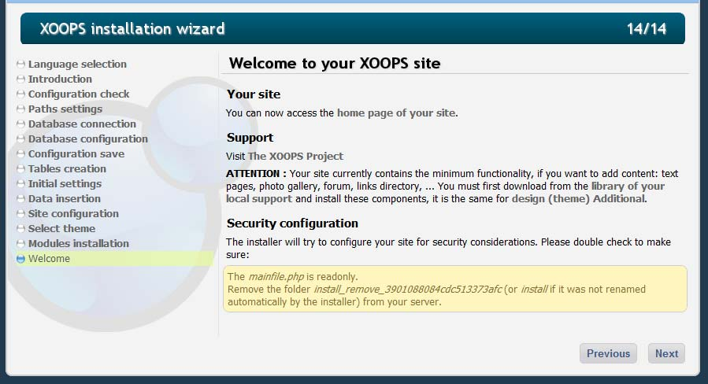
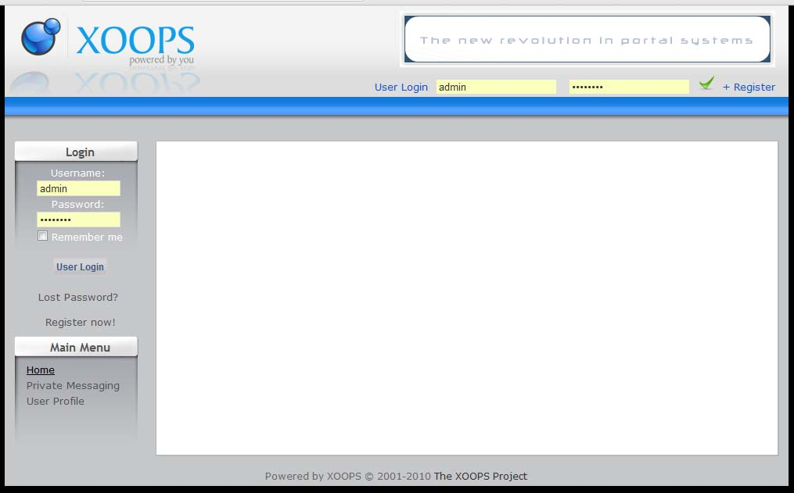
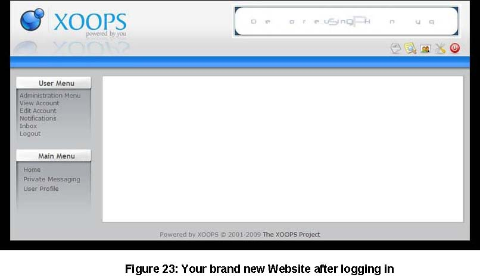
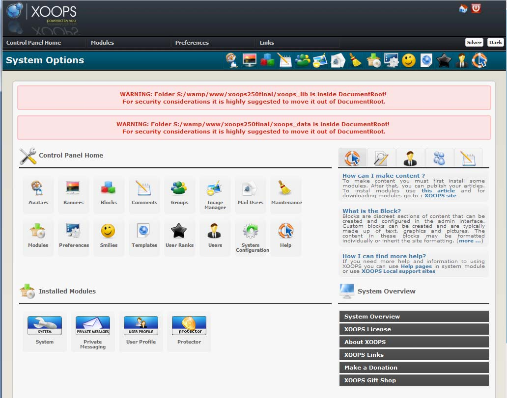
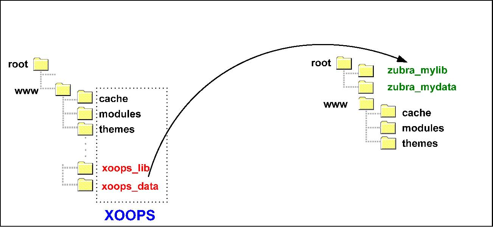
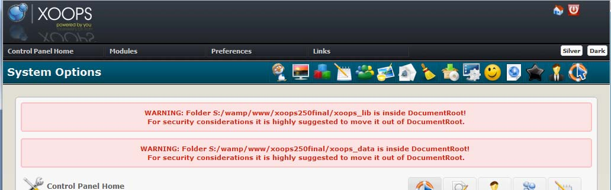
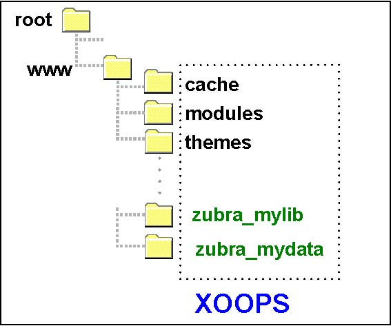

# Chapter 8: Ready to go!

If everything has gone as planned, the final installer screen looks like this:



Figure 21: Final installation screen

## Install directory cleanup

For security, XOOPS removes access to the installer at the end of the process. In 2.7.0 this is done automatically:

1. The installer writes an **external cleanup script** (for example `install_cleanup_abcd1234.php`) into the web root. The script name contains a unique suffix so it cannot be predicted.
2. When the final page loads, JavaScript posts to that cleanup script via AJAX.
3. The cleanup script renames the `install/` directory to `install_remove_<unique-suffix>` and then deletes itself.
4. If the external script cannot be created, the installer falls back to the older `cleanup.php` mechanism.

When the cleanup finishes, `mainfile.php` and `secure.php` are also set to read-only (`0444` on Linux/macOS) and the installer directory can no longer be reached through the browser.

**After the installer completes, delete the renamed `install_remove_…` folder from your server.** Keeping a disabled but present installer directory is a minor but avoidable risk.

Click **[Next]** to close the wizard and open the home page of your new site:



Figure 22: XOOPS home page

## First login

Log in using the webmaster account you created during the wizard. Once the password is accepted, the User Menu appears and the home page switches into logged-in mode.



Figure 23: The site after logging in as the administrator

Open the **Administration** link to enter the Control Panel:



Figure 24: Control Panel home

The first time you enter the Control Panel, the admin theme runs a series of warnings if anything in your environment still needs attention.

## Post-install warnings

On a production install, the admin area typically displays two or three warnings:

1. **`mainfile.php` should be set to read-only** (`0444` on Linux/macOS). The installer already attempts this, but some hosts revert the permissions. The same applies to `xoops_data/data/secure.php`.
2. **`xoops_lib/` and `xoops_data/` should be moved outside the document root.** These are the directories referenced by `XOOPS_PATH` (alias `XOOPS_TRUST_PATH`) and `XOOPS_VAR_PATH`.

> **Warning**
>
> Keep `xoops_lib/` and `xoops_data/` **outside** the document root whenever possible. If your host does not allow that, at least rename them to non-obvious names.

The document root on a shared host can be any of:

- `htdocs`
- `httpdocs`
- `html`
- `public_html`
- `web`
- no explicit name at all (some control panels)

Imagine the document root is named `www`. Use FTP or SSH to move `xoops_lib/` and `xoops_data/` up one level, renaming them to something non-obvious at the same time:



> **Caution**
>
> If your host does not permit directories outside the document root, consider switching hosts. If that is not an option, at least rename both directories.



> **Info**
>
> To silence these admin warnings, set `"admin_warnings_enable" => 0` in `xoops_data/configs/xoopsconfig.php`.

If you cannot move the directories up one level, an acceptable layout is:



## Updating path constants after moving the directories

After moving `xoops_lib/` and `xoops_data/`, update the path constants in **`mainfile.php`** (not `secure.php`) so they point to the new locations. The relevant constants in `mainfile.php` are:

```php
// Physical path to the XOOPS documents (served) directory WITHOUT trailing slash
define('XOOPS_ROOT_PATH', '/root/www');

// Physical path to the XOOPS library directory WITHOUT trailing slash
define('XOOPS_PATH', '/root/zubra_mylib');

// Physical path to the XOOPS datafiles (writable) directory WITHOUT trailing slash
define('XOOPS_VAR_PATH', '/root/zubra_mydata');

// Alias of XOOPS_PATH, kept for backwards compatibility
define('XOOPS_TRUST_PATH', XOOPS_PATH);
```

`secure.php` holds the database credentials and does **not** redefine these path constants. If you inherited documentation from XOOPS 2.5.x that told you to edit path constants in `secure.php`, ignore it on 2.7.0.

## Production settings

`mainfile.dist.php` ships with production-friendly defaults that `mainfile.php` should keep on a live site:

```php
define('XOOPS_DB_LEGACY_LOG', false); // disable legacy SQL usage logging
define('XOOPS_DEBUG',         false); // disable debug notices
```

Only set either to `true` in a development environment when you are actively investigating legacy DB usage or deprecated notices.

## That's it

The installation is complete. Visit [https://xoops.org](https://xoops.org) to find additional modules, themes, and documentation. Comments about this guide can be sent to [documentation@xoops.org](mailto:documentation@xoops.org).
